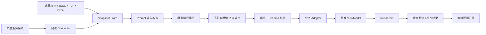

# Prompt Studio｜首版产品需求 + 技术实现规范 v1.0（冻结基线）

> 文档用途：交给 Codex 或工程团队直接拆分任务、编码、测试、验收。  
> 状态：产品架构与首版交互设计基线；**不声称已接入现有九立接口**。  
> 决策：方案 C——**独立 Prompt Studio + 九立只读连接 + 隔离测试快照**。  
> 依据：用户确认的产品规划与九立 P1/P2/P3/P4 原始 Prompt v2.0、两份会议纪要。此前讨论的 v2.1 风险字段被纳入兼容范围；若实际 v2.1 JSON Schema 尚未提供，适配器以“可选增强字段”处理，不能凭描述伪造最终契约。  
> 范围：Web 桌面端优先，首版九立专用视图、底层通用协议；不直接替代九立业务工作台。

---

## 0. 决策摘要（冻结，不需 Codex 再自行讨论）

1. **数据连接**：只读读取九立 Demo 中有权限访问的客户、委托任务、委托商品、查货商品、已知商品关系、必要文件元数据；仅经显式用户操作导入到 Playground 的**快照**。不存在任何写回九立的路径。
2. **模型输出**：保存准确的原始响应 `raw_response`；仅做解析、校验、标准化；不可对原始内容进行 AI 二次“智能补全”。
3. **渲染协议**：`RawResponse → ParseResult → SchemaValidation → BusinessAdapter → ViewModel → Renderer`；保留失败信息；各层数据单独存储。
4. **四套视图**：P1 宽表+前置问题；P2 入仓号分组+合并/原始行；P3 候选表+关系图；P4 逐字段决策+Patch 预览。共享 JSON、证据查看、搜索定位能力。
5. **界面**：IDE 式导航/编辑/结果三栏；结果区四主标签“可视化 / 原始 JSON / 结构校验 / 运行信息”；可调整宽度和最大化；底部执行历史折叠。
6. **运行**：支持“导入 JSON 仅渲染”“真实模型单节点运行”“保存快照回放”；完整 P1→P4 自动编排、正式 A/B 评测与批量跑样本不是首版交付门槛。
7. **标注与评价**：用户标注“模型错了 / 正确值 / 错误原因”独立保存；不反向改模型输出、九立池或原始附件。
8. **默认展示**：业务视图优先，但始终可以一键回到原始 JSON；JSON 不合法时不能出现“业务解析成功”的误导。

### 0.1 产品目标与成功条件

目标用户：首先是九立 AI 核对项目的提示词工程师、开发、产品/FDE；之后是其他需要调试结构化输出的团队。

首版成功不是“组件多”，而是用户能独立完成：**选 Prompt → 导入真实任务或离线样本 → 调整 Prompt → 运行 → 看业务化输出 → 定位错误 → 保存本次运行与标注**。使用者无须手动复制 JSON 去其他网站进行表格处理。

首版可验证成功标准：P1/P2/P3/P4 的主要输出均有专用渲染；JSON 解析问题正确显示；点击字段能到 JSON 路径；有证据时能定位来源（无证据时有明确降级）；同一运行回放一致；九立只读连接的写操作测试均被拒绝。

### 0.2 明确不做

- 不重做九立业务首页、人工核对、封版、核销、占用管理等生产功能。
- 不创建/更新九立客户、订单、委托草稿、查货池、关系、Patch、核销数据；不得调用业务系统写 API。
- 不要求 P1/P2/P3/P4 修改成 HTML、Mermaid、React 组件输出；也不以模型二次改写代替确定性 Adapter。
- 不首版建设拖拽式 Renderer Builder、通用 Agent 编排平台、完整 Prompt 发布审批、多人任务锁、规模化批处理与线上实验统计。
- 不凭业务 JSON 计算“字段准确率”，没有 Gold Answer 只显示“未评测”；Schema 合法不代表事实准确。

---

## 1. 系统结构与数据隔离



强隔离：`jiuliConnector.read*` 仅能读 → `snapshot` 保存到 Prompt Studio 自有存储 → 所有运行与标注发生在独立域。运行中的 `customer_id/order_row_id/raw_row_id` 只是外部对象引用，不是执行写操作授权。

### 1.1 九立只读导入的具体语义

连接前提：用户在 Prompt Studio 中配置有权限的只读服务端凭据或内部服务代理；网络能力不足时提供“文件/JSON 导入”，不阻断首版离线使用。**不假定现有九立 Demo 已经存在下述接口。** Codex 应先阅读仓库确认实际可调用源，再以适配器对齐。

单次导入场景：

1. 用户点“从九立导入”，选择客户（搜索）、委托任务或查货批次；
2. 系统只读加载任务摘要、委托行、相关查货候选、商品关系和文件元数据；
3. 用户勾选本次调试要带的上下文及文件；
4. 系统构建快照、校验引用和文件授权、存储快照 ID、来源、导入时间、内容 Hash；
5. 选择 P1/P2/P3/P4 后，根据不同 Prompt 的 `InputBuilder` **显式构造**相应输入，显示“实际发送的内容预览”；
6. 点击运行时不得再隐式拉取新业务数据；若需更新必须由用户点“刷新并生成新快照”，保留旧快照以支持比较。

读取范围：客户基本信息（仅用户授权范围）、任务/草稿版本、原始委托商品行、已存在查货逻辑单/合并产品/原始商品行、来源引用、文件元数据以及预览内容（在授权且有实现时）。没有权限读取某项应返回受限状态而非假装为空。

最小 Connector 接口（TS 概念契约，**不宣称现有 URL 已存在**）：

```ts
interface JiuliReadonlyConnector {
  capabilities(): Promise<ReadCapability>;
  searchCustomers(q: string, page: number): Promise<CustomerSummaryPage>;
  listOrderTasks(customerId: string, page: number): Promise<OrderTaskPage>;
  listInspectionBatches(customerId: string, page: number): Promise<InspectionBatchPage>;
  getTaskFacts(taskId: string): Promise<OrderTaskFacts>;
  getInspectionFacts(customerId: string, batchIds: string[]): Promise<InspectionFacts>;
  getRelations(taskId: string): Promise<RelationFacts>;
  getMaterialMetadata(fileIds: string[]): Promise<MaterialMetadata[]>;
  getPreview?(fileId: string, locator?: SourceLocator): Promise<AuthorizedPreview>;
}
```

接口可能映射为现有 REST/DB 查询/本地 Demo mock 数据，但服务端必须有显式 allowlist；外部 Connector 不暴露任意 HTTP 请求或数据库 SQL 执行器。用户不提供连接时使用 `LocalFixtureConnector`。

### 1.2 快照结构

快照 `InputSnapshot` 至少保存：

- `snapshot_id`、`project_id`、`source_type`（`FILE_IMPORT | JSON_IMPORT | JIULI_READONLY`）；
- `source_ids`（客户/任务/批次的外部 ID）与 `source_version`（若能获取）；
- `imported_at`、`content_hash`、`data_contract_version`；
- `raw_material_ids`（授权文件引用）与 `normalized_payload`（导入时取得的只读事实）；
- `warnings`（缺元数据、某个文件不可读、源版本未知等）；
- `redaction_policy` 与 `snapshot_visibility`（访问控制）；
- `input_builder_version`（从快照生成 P1～P4 输入的构造器版本）。

只读连接是**能力之一**，不是第一版唯一入口。离线导入 JSON / PDF / Excel 为同等一等公民。敏感数据应保持原始引用与权限，不建议无限复制所有客户的真实材料；按用户选择的任务范围导入，并支持到期删除。

---

## 2. Prompt、Run 与版本契约

### 2.1 Prompt 对象

`PromptDefinition { prompt_id, project_id, prompt_kind, name, active_schema_id, renderer_id }`；`PromptVersion { version_id, prompt_id, label, system_prompt, user_prompt_template, variables_schema, created_at, parent_version_id }`。

首版 Prompt 种类 `JIULI_P1 | JIULI_P2 | JIULI_P3 | JIULI_P4 | GENERIC_JSON`。系统必须记录实际发送的**展开后**提示词（允许涉密信息脱敏显示），不能只记录版本号。

提示词可以保存版本。修改尚未保存时可点击运行，`Run` 中记录 `is_unsaved_draft=true` 及发送内容 Hash。运行不自动覆盖已保存正式版本。

### 2.2 一次 Run 的完整信息

`Run` 必须绑定：

`run_id, project_id, prompt_id, prompt_version_id? , input_snapshot_id, model_provider, model_name, provider_adapter_version, model_params, actual_prompt_hash, built_input_hash, schema_id, schema_version, adapter_id, adapter_version, renderer_config_version, started_at, ended_at, status, raw_response, parsed_json?, parse_diagnostics[], schema_diagnostics[], view_model?, token_usage?, latency_ms?, estimated_cost?, error?`。

`Run.status` 建议区分 `CREATED | RUNNING | SUCCEEDED | MODEL_ERROR | PARSE_ERROR | SCHEMA_INVALID | ADAPTER_ERROR | CANCELLED`；不要把业务问题 `CONFLICT` 视为 API 调用失败。

对于模型无法返回 Token/费用的数据，展示 `unknown`，不可凭空推算“真实值”。估算费用必须标明来源和估算口径。

### 2.3 三种运行模式

- `RENDER_ONLY`：粘贴/导入原始 JSON，直接进入解析、校验与渲染，不调用模型。M0 必须支持。
- `MODEL_RUN`：使用已配置模型调用，运行前选择快照和构造输入，返回并持久化模型响应。M1 必须支持。
- `REPLAY`：读取历史 Run 的不可变输出与当时关联的快照，使用原适配器版本回放；若用更新后的渲染器重新展示，需标明“仅重新渲染”，不覆盖历史结果。M1 必须支持。

模型调用必须由服务端代理，不让 API Key 进入浏览器。文件预处理链路存 `preprocessor_version` 和原文件 Hash，避免同一样本因预处理变化而不可比。首版不强制所有厂商模型都支持文件直传；对不支持的模型要拒绝并解释或走明确配置的预处理链路。

---

## 3. 渲染协议 v1（核心冻结）

### 3.1 流水线

1. **Raw**：精确保留模型回复文本/结构化 payload 与响应元数据；不得静默补齐缺字段、修改数字或自动替换错字。
2. **Parse**：尝试解析 JSON，保留原文到 JSON 节点的路径与解析错误位置；接受完整 JSON 响应，不将任意 Markdown 正文猜成业务 JSON。对 fenced JSON 的兼容必须以可追溯显式提取为前提。
3. **Validate**：按 `schema_version + prompt_kind` 查 Schema Registry；返回 `VALID | INVALID | UNKNOWN_SCHEMA`，错误携带 JSON Pointer、期望类型与实际类型；**部分可展示**不等于 Schema 合法。
4. **Adapt**：纯确定性函数，输入 `parsed_json + schema_id + context`，产出 `ViewModel`；禁止调用 LLM 补齐表格或关系；输出诊断。
5. **Render**：只读取 `ViewModel + RendererConfig + SelectionState`，不直接改业务原始 JSON。所有动态 HTML/Markdown 只作为转义文本显示，不执行脚本。

### 3.2 ViewModel 的标准定义

```ts
type JsonPointer = string; // RFC6901，例如 /output/rows/0/values/model
type RefId = string;
interface Cell { rowId: string; fieldKey: string; value: unknown; state?: 'PRESENT'|'EXPLICIT_NONE'|'SOURCE_BLANK'|'NOT_DETECTED'|'UNREADABLE'|'AMBIGUOUS'; jsonPointer: JsonPointer; sourceRefIds: RefId[]; }
interface TableView { id: string; title: string; columns: {key:string; title:string; kind?:'text'|'number'|'state'; fixed?:boolean}[]; rows: {id:string; sourceRefIds?:string[]; cells:Record<string,Cell>}[]; }
interface IssueView { id:string; type:string; severity?:'INFO'|'WARNING'|'BLOCKER'|'UNKNOWN'; summary:string; detail?:string; target?:{tableId?:string; rowId?:string; fieldKey?:string; jsonPointer?:JsonPointer}; sourceRefIds:string[]; origin:'MODEL_FINDING'|'SCHEMA'|'ADAPTER'|'RULE'|'ANNOTATION'; }
interface RelationView { id:string; fromId:string; toIds:string[]; status:string; sourceRefIds:string[]; jsonPointer:JsonPointer; coverage?:unknown; evidence?:unknown[]; }
interface ChangeView { id:string; rowId:string; field:string; action:string; before:unknown; after:unknown; candidate?:unknown; ruleId?:string; verificationStatus?:string; sourceRefIds:string[]; jsonPointer:JsonPointer; }
interface EvidenceView { id:string; fileId:string; fileName?:string; page?:number|null; sheet?:string|null; row?:number|null; column?:string|null; rawText?:string|null; availability:'AVAILABLE'|'METADATA_ONLY'|'MISSING'|'FORBIDDEN'; }
interface Diagnostic { phase:'PARSE'|'SCHEMA'|'ADAPTER'|'RENDER'; level:'ERROR'|'WARNING'|'INFO'; code:string; message:string; jsonPointer?:JsonPointer; }
interface ViewModel { viewModelVersion:'1.0'; runId:string; rendererId:string; tables:TableView[]; issues:IssueView[]; relations:RelationView[]; changes:ChangeView[]; evidence:EvidenceView[]; diagnostics:Diagnostic[]; }
```

可扩展：不新增第六套业务专属渲染系统；后续通用 Prompt 通过新增 Adapter 产生上述对象即可。若确有时序图等新需求，用新组件消费约定的通用 `GraphView` 扩展，而不是修改四份业务 Prompt 输出格式。

### 3.3 RendererConfig

```json
{
  "renderer_id": "jiuli-p1",
  "renderer_config_version": "1.0.0",
  "adapter_id": "jiuli-p1-v2",
  "layout": "wide-table-with-issues",
  "regions": [
    {"id":"table", "component":"data-table", "binding":"tables.orderRows"},
    {"id":"issues", "component":"issue-list", "binding":"issues"},
    {"id":"evidence", "component":"evidence-viewer", "binding":"evidence", "mode":"drawer"}
  ]
}
```

**渲染配置只能引用白名单组件**：`data-table, issue-list, relation-canvas, field-diff, evidence-viewer, run-metadata, summary-strip`。`binding` 使用登记的 ViewModel 名称/逻辑选择器，不支持执行任意 JS 表达式。必须校验配置版本、组件类型、字段引用路径和安全规则。

### 3.4 全局选择与跨组件联动

`SelectionState { runId, tableId?, rowId?, fieldKey?, issueId?, relationId?, sourceRefId?, jsonPointer? }`，所有组件读/写同一状态。选择动作的行为：

- 点击表格单元格 → 选中 `rowId + fieldKey` → JSON 路径高亮 → 展示可获取的来源引用；
- 点击问题 → 定位目标行/字段 → 同步展开证据；
- 点击关系线 → 选中当前委托商品与查货 `raw_row_ids` → 显示匹配证据与覆盖；
- 点击 Patch → 显示 `decision/current_value/result_value/rule_id/source_refs`；
- 切换“可视化/原始 JSON/结构校验/运行信息”后，选择状态保持；数据不存在或权限不足则展示“无法定位”而不是跳错对象。

**对象定位不能依赖当前表格序号**；唯一键首选业务 local_ref/id；同一快照中出现重复引用须显示诊断并引入稳定的 `sourcePath` 辅助标识，禁止静默合并。

### 3.5 校验和降级

| 数据状态 | 默认界面 | 用户可做什么 |
|---|---|---|
| JSON & Schema 均通过 | 渲染业务视图，允许切 JSON | 浏览/定位/标注 |
| JSON 有效，Schema 无效 | 展示结构错误；对可安全理解的部分可局部渲染，标“非完整结果” | 定位错误、复制原值 |
| 原始文本不是 JSON | 原始文本 + 解析诊断；不生成猜测业务表格 | 查看/复制原文 |
| Schema 未登记 | JSON Tree + UNKNOWN_SCHEMA；不强制套用九立模板 | 选择正确 Schema 或登记新版本 |
| 有 source_ref，但附件不可访问 | 显示来源文件/页行元信息和 `METADATA_ONLY` | 手动找原文件，提示权限或缺失 |
| Adapter 抛异常 | 记录 ADAPTER_ERROR；保留原始 JSON 与校验结果 | 查看异常定位/上报 |

不要将“字段为空”“数值为 0”“明确无牌”“模型未识别”“来源不存在”混成相同状态。

### 3.6 Prompt Schema 版本兼容

v2.0 真实原始结构（来自上传的 Prompt 文档）：

- **P1**：`output.customer_resolution`、`output.source_refs[]`、`output.rows[]`（每行 `row_seq/local_row_ref/source_position/values/normalized_identity/field_sources/field_conflicts`）、`output.source_total_facts`、`output.warnings`；`values` 固定 25 个业务键。
- **P2**：`output.logical_inspections[]`（`warehouse_no/header_facts/raw_rows/merged_products/scope_uncertain`）、`output.source_refs[]`、`output.unresolved_scopes`、`output.warnings`。
- **P3**：`output.row_relations[]`（`order_row_id/match_status/selected_group/coverage/match_evidence/confidence/candidate_groups/weak_candidates`）、`output.warnings`。
- **P4**：`output.row_patches[]`（`order_row_id/field_decisions[]/row_verification`）、`output.base_draft_version`、`output.warnings`。

适配器用版本化注册：`(promptKind, schemaVersion) → {schema, adapter, rendererConfig}`。先以可获得的 v2.0 完整样例验收；v2.1 可选增强字段包括：P1/P2 `precheck_findings`、`row_integrity`、事实状态；P3 `relation_review_status/difference_flags/unmatched_reason`；P4 `review_findings/manual_overlay/field_locks`（后两项可能属于**输入**，取决于最终契约）。接到 v2.1 实际 Schema 后单独注册，**不可将不确定字段当成已经存在的 v2.0 属性**。

---

## 4. 四套业务视图模板（冻结）

### 4.1 P1｜委托识别：宽表 + 内部问题区 + 来源

- 顶部轻量统计：原始商品行数、识别商品行数、问题数、输入材料数；不能把统计当作业务准确率。
- 主体表格展示 `output.rows` 的 25 个 `values` 字段；可横向滚动、固定“序号/型号”，可切换核心字段与全部字段；行 ID 用 `local_row_ref`，字段来源来自 `field_sources` 或字段关联的来源 Ref。
- 下部问题区：聚合 P1 `field_conflicts`、可结构化的 `warnings`，以及真实 v2.1 `precheck_findings`；去重只能按明确可比的 `issueId + rowId + field + sourceRefs + category`，不能仅按消息文本合并。
- 点击问题定位行/字段；展示委托原值、发票/箱单候选值、来源、冲突类型（若有）；对没有具体字段的 warning 展示为一般警告，不伪造位置。
- 来源：选择单元格显示 `source_refs` 原文；无来源为“未提供来源”而不是证据通过。
- 典型 fixture：委托与发票单价 10/11 冲突、品牌明确“无牌”、缺失品牌、主体 4 行但模型少提 1 行（漏行需 Gold 标注/行完整性依据才能判定）。

### 4.2 P2｜查货识别：按入仓号分组 + 合并产品 + 原始行

- 一层：`logical_inspections[]` 按逻辑查货单分组，显示 `warehouse_no/scope_uncertain`、各类 `header_facts`；没有有效入仓号不得自动伪造分组。
- 二层：`merged_products[]`，显示 `merge_key` 和 `aggregated`（数量、件数、净重、毛重），可展开 `raw_row_refs`。
- 三层：通过 `raw_row_refs` 展示 `raw_rows[]` 的真实 `facts`、`relation_features`、`origin_facts`、`manual_marks`、`package_facts`、`weight_facts`；不能物理删除合并前原始行。
- 问题区：显示 `unresolved_scopes`、`scope_uncertain`、合并产品 `field_conflicts`、真正可解析的 `warnings` 及 v2.1 `precheck_findings`。
- 交互：按入仓号查找、查看合并/原始行、对比合并范围、来源定位。注意不把毛净重和 Pack 的来源范围简单平均或反向推算。
- 典型 fixture：同仓号多页、多原始行合并；手写 0/O 模糊；入仓号不确定；COD/COA 及印刷 Origin 具有不同来源优先级但 P2 不作最终裁决。

### 4.3 P3｜商品关系：候选对比主视图 + 关系图切换

- 默认布局：左侧委托商品列表、中间候选组/查货原始行表格、右侧证据详情；支持“候选表/关系图”视图切换；关系图不得替代大批量数据表。
- v2.0 `match_status ∈ {MATCHED, MULTIPLE_CANDIDATES, UNMATCHED}`，附 `selected_group.sources[]` → `logical_inspection_id/merged_product_id/raw_row_ids`；渲染 `coverage.status/order_quantity/independent_scope_evidence` 和 `match_evidence[]`。
- `candidate_groups/weak_candidates` 保留每个候选，不能为空时静默选第一条；没有候选是否是“查货尚未到达”需要系统独立提供快照上下文，**不从 `UNMATCHED` 猜原因**。
- 对 v2.1 显示 `relation_review_status` 和 `difference_flags`，明确“关系成立”≠“关系可自动应用”；黄色人工门控由运行环境的策略/显式输出决定，不是让关系图决定生产核销。
- 关系图 nodes/edges 完全从 `row_relations` 构建，边连接原始查货行；点击边看来源证据；多个来源可成组展示；不得因数量 400+600=1000 就自行判定关系成立。
- 支持人工“标注正确候选/标注错误关系”**仅用作评测注释**，不触发 P3 重算或改九立客户池。
- 典型 fixture：完全匹配、前后缀差异、多个候选、无候选但池有商品、查货尚未来、两批查货共同覆盖、部分覆盖。

### 4.4 P4｜字段核验：决策表 + 风险区 + 只读 Patch 模拟

- 展示 `output.row_patches[]`，按 `order_row_id` 分组；每行 `field_decisions[]` 显示 `field, current_value, result_value, decision, verification_status, rule_id, source_refs, conflict_values`。
- 决策枚举：`KEEP | FILL | UPDATE | CONFLICT | MISSING | NO_ACTION`；状态例如 `VERIFIED_CONSISTENT/VERIFIED_UPDATED/CONFLICT/MISSING_REQUIRED/NO_EVIDENCE/NOT_CHECKED`。原值相同也可能是没有证据，不可直接显示“核验通过”。
- 默认提供“全部字段 / 只看变化 / 仅风险”；可显示 v2.1 的 `review_findings` 及人工锁提示。
- `PatchPreview` 以输入草稿快照 `base_draft_version` 为基准，在内存模拟可应用 Patch：只有策略允许的字段变更才显示“模拟新值”；CONFLICT / MISSING / 不满足门控的变更不能自动应用。模拟结果与模型声称的 `result_value` 是不同列，不隐式写盘。
- 预览必须标注 `SIMULATION_ONLY`，**禁止将模拟 Patch 写回九立 Demo**；没传入完整草稿快照就只展示候选决策，不虚构“整行最终值”。
- 典型 fixture：KEEP 无证据、FILL 空字段、UPDATE 产地、CONFLICT、多来源范围不完整、人工锁无法更新、晚到材料影响某行。

### 4.5 各视图统一 UI 合约

点击一个对象后统一通过 `SelectionState` 跳转；风险以源事实和规则派生，不将模型自报的 HIGH 作为准确率；字段证据无权访问时安全降级；人工纠错标注与模型输出分层；原始输出可从任何视图打开。

---

## 5. 主界面信息架构与交互（冻结）

### 5.1 导航

- 左侧 Sidebar（默认约 220px，可折叠）：项目选择、P1/P2/P3/P4、样本、运行历史、连接设置。
- 顶栏：面包屑项目/Prompt、当前 Prompt 版本、模型、运行按钮、保存、对比历史结果入口。
- 编辑区（桌面初始约 42%）：Prompt 编辑器（System/User/变量）、输入模式（离线文件/JSON/九立快照/历史 Run）、模型和参数、展开后请求预览。
- 结果区（约 58%）：四主标签 **可视化 / 原始 JSON / 结构校验 / 运行信息**；结果可一键放大，全屏时仍能快速切回编辑。
- 底部：执行历史/日志折叠面板，默认不挤压业务宽表。
- 证据查看：右侧抽屉或浮动分屏，展示文件预览/来源定位，按文件授权决定能力；不能无限增加固定栏。

### 5.2 交互状态机

`IDLE → INPUT_READY → RUNNING → RESULT_AVAILABLE`；运行错误进入 `ERROR`，可回看失败原文和错误消息。修改 Prompt 或输入后状态变 `DIRTY`，已有旧结果继续显示，但必须标“当前结果来自上次运行（与未保存编辑不同）”。

选择新 Prompt 时可以保持各 Prompt 独立工作草稿和上次 Run；切换模型/版本不自动运行。表格滚动、JSON 定位和证据面板的选择状态归属于某次 Run。

点击“运行”前必须明确模型、输入快照、是否真实发送文件、相应 Provider 是否支持该 MIME；真实请求失败不能悄悄回退为 Mock 并显示成功。连接失效时只读导入报错，但离线样本仍可使用。

### 5.3 主路径（手动即可完成）

1. 进入项目、选择 P1；自动加载 Prompt、对应 Schema/Renderer。
2. 通过拖拽文件/选择已有离线 JSON/“从九立导入”获取测试输入。
3. 调整 Prompt 与模型，预览实际发送内容。
4. 点击运行，保存完整 Run 快照、原始响应与诊断。
5. 默认业务可视化，点错误字段高亮 JSON 和来源；可切换完整 JSON 树。
6. 对错误填写独立标注，保存；可与另一历史 Run 手动并排查看；无需首版计算跨版本统计准确率。
7. 需要新数据时手动重新导入创建新快照；不覆写旧 Run。

### 5.4 基础响应式与可用性

最先支持桌面宽度 ≥1280px；低于此宽度自动把左右两面板改为可切换页签并保留全屏结果；不追求手机上完成 25 字段宽表复核。主要文字不宜过小，禁用固定全页高度导致多层滚动迷宫；宽表采用虚拟化/固定列，仅当数据量证明必要时优化性能。

---

## 6. 后端与存储设计

### 6.1 最小数据表/实体

| Entity | 主键 | 关键关系与约束 |
|---|---|---|
| `projects` | project_id | 数据与权限隔离顶层 |
| `prompts` | prompt_id | `project_id`, kind, schema_id, renderer_id |
| `prompt_versions` | version_id | 只新增，不原地覆盖历史文本 |
| `connections` | connection_id | 只保存只读凭据的秘密管理引用、能力、状态，不回传明文 |
| `input_snapshots` | snapshot_id | `project_id, source, hash, imported_at, payload_ref` |
| `input_materials` | material_id | `snapshot_id, content_hash, media_type, authorized_file_ref` |
| `runs` | run_id | `snapshot_id, prompt_version?, config, raw_ref, diagnostics, VM_ref` |
| `annotations` | annotation_id | `run_id, target_json_pointer, expected_value, issue_type, note` |
| `renderer_configs` | config_id | `renderer_id, version, JSON config` |
| `schemas` | schema_id | `prompt_kind, schema_version, JSON Schema, registry_version` |

首版可使用 SQLite + 本地私有文件目录；实现存储 Repository 接口，后续迁移 PostgreSQL / S3 不改变业务层。代码项目如已有栈则优先复用，不为满足推荐栈而重构整个九立仓库。

### 6.2 Prompt Studio 自有 API（目标接口，不宣称已有）

| 路径 | 方法 | 行为 |
|---|---|---|
| `/api/projects` | GET | 项目列表 |
| `/api/prompts/:id` | GET | Prompt 与可用版本、Schema/Renderer |
| `/api/prompts/:id/versions` | POST | 创建不可变 PromptVersion |
| `/api/snapshots/import` | POST | 离线 JSON/文件导入、保存快照 |
| `/api/connectors/jiuli/capabilities` | GET | 测只读能力与权限 |
| `/api/connectors/jiuli/customers` | GET | 搜客户，分页 |
| `/api/connectors/jiuli/tasks` | GET | 按授权客户列任务 |
| `/api/connectors/jiuli/snapshots` | POST | **在 Studio 中创建快照**：读取外部数据，不向九立 POST；禁止在“目标源 API”使用写动作 |
| `/api/runs` | POST | 创建并执行独立 Run |
| `/api/runs/:id` | GET | 查询完整 Run、诊断与 ViewModel |
| `/api/runs/:id/re-render` | POST | Studio 内只重跑解析/视图；历史原文不可改 |
| `/api/runs/:id/annotations` | POST | 保存该次 Run 独立纠错标注 |
| `/api/materials/:id/preview` | GET | 严格授权下读取已导入材料/源预览 |

每个 API 使用明确类型化响应：`{ok:true, data, request_id}` 或 `{ok:false, error:{code,message,details?}, request_id}`；UI 将请求失败与 Schema 校验失败分别显示。

### 6.3 只读 Connector 的安全红线

1. 生产配置只允许读取 API / 已经验证的只读数据库角色；**所有有副作用的业务调用（包括 PATCH、PUT、DELETE、带写语义的 POST）禁止**。
2. Studio 内自己的 `POST /snapshots`、`POST /runs` 允许写**Studio 私有数据库**，不代表允许写九立。
3. 不向浏览器暴露连接密钥；服务端校验操作者是否能访问该客户/任务，防止用猜 ID 跨客户读取。
4. 请求路径、文件标识、远程 URL 都必须经过 allowlist、权限验证，防 SSRF 与路径穿越；不可把外部响应字段当任意 HTML 执行。
5. 需要选择上传/下发至外部模型时明确展示 Provider；数据出境、留存和敏感文件处理遵守组织规则；默认不自动把全部客户数据发给模型。
6. 错误信息、日志、Run 展示里的密钥/令牌/内部地址等敏感信息须屏蔽。

---

## 7. 推荐技术实现方式

- `Next.js + TypeScript`（新项目默认；若实际仓库已采用可复用框架，先评估并说明）；
- `Tailwind + shadcn/ui` 构建深浅主题与可调整面板；
- `Monaco` 编辑 Prompt、JSON 和 Diff；
- `TanStack Table` 实现业务表格；
- `React Flow` 实现 P3 关系图，`Mermaid` 用于通用静态流程图且禁用不受信任的脚本；
- `Ajv + JSON Schema` 校验源 Schema / RendererConfig；
- `Server Provider Adapter` 统一不同模型供应商调用，保留请求/响应原文及运行能力差异；
- `Repository/Connector/Adapter/Renderer` 分层，不在单个页面组件里到处解析九立字段。

示例目录：

```text
src/
  app/(studio)/projects/[id]/playground/page.tsx
  app/api/{runs,snapshots,connectors,materials}/...
  components/playground/{sidebar,prompt-editor,input-panel,result-tabs,run-history}/...
  components/renderers/{data-table,issue-list,relation-canvas,field-diff,evidence-viewer}/...
  lib/contracts/{run,view-model,renderer-config,snapshot}.ts
  lib/schemas/registry.ts
  lib/adapters/{registry,jiuli-p1-v2,jiuli-p2-v2,jiuli-p3-v2,jiuli-p4-v2}.ts
  lib/connectors/{types,jiuli-readonly,local-fixture}.ts
  lib/models/{provider-adapter,model-gateway}.ts
  lib/input-builders/{p1,p2,p3,p4}.ts
  lib/repositories/{runs,snapshots,prompts,annotations}.ts
  fixtures/jiuli/{p1,p2,p3,p4,invalid-json,schema-invalid}/...
  tests/{unit,adapter,ui,e2e,security}/...
```

如果 Codex 在已有仓库开发，目录仅为参考。**先扫描仓库复用已有文件预览、Schema、鉴权、原始文件读取能力；不要复制整套业务逻辑进入 Studio。**

---

## 8. 分步交付与验收（可直接建 issue）

### M0｜零模型费用的渲染验证（必先完成）

- 建立 `Run`/`ViewModel` 契约、Schema 注册器和解析诊断；
- 编写 P1～P4 四个 Adapter，使用上传的 v2.0 输出 JSON 作为基础 fixture；
- 实现表格、问题、关系、差异、证据元数据组件；
- 完成渲染模板布局与 `SelectionState` 联动；
- 实现 `RENDER_ONLY` 导入 JSON，不调用模型；
- 实现三种异常降级：无效 JSON、Schema 无效、来源不可访问。

**验收**：4 个模板均可打开；真实字段路径定位正确；不修改任何输入 JSON；两个错误 fixture 明确报错。

### M1｜真实 Playground + 只读导入（首版完成条件）

- 编辑器、参数、文件/JSON/快照输入、真实模型网关；
- Studio 自身持久化 PromptVersion、InputSnapshot、Run、Annotation；
- 九立 Connector（若实际只读接口不存在先交付 FixtureConnector + 明确未连接状态，并提供经授权只读接入的 Adapter 占位）；
- 支持手动选择客户/任务/批次并导入，建立隔离快照；
- 历史回放、模型错误展示、权限错误展示、选择结果标注；
- 结果区可放大、左右栏可调整、执行信息独立展示。

**验收**：能够从九立读取真实授权任务并导入（若源接口实际具备）；完成 P1～P4 各一次真实或在能力不匹配时明确声明的替代测试；原始输出、输入快照、Prompt 版本可复查；业务源无写回。

### M2｜明确后续增强（不阻塞首版）

- 真正的 A/B 指标评测、Gold Answer、批量样本回归；
- 多模型对比矩阵；
- P1→P4 自动执行/从失败节点续跑；
- 自定义拖拽模板 Builder、团队协作与权限高级功能。

**允许的轻量对比**：M1 可手动选择两次历史 Run，进行字段与 JSON diff；不要将其包装成有准确率保证的正式评测系统。

---

## 9. 逐项验收测试（最低 20 条）

| ID | 用例 | 验收标准 |
|---|---|---|
| AT01 | P1 v2.0 含 25 字段结果 | 按真实 25 键渲染，无缺列/误映射 |
| AT02 | P1 含多行及字段冲突 | 点击冲突定位正确行/字段/原文引用 |
| AT03 | P1 无牌 vs 空白 vs 0 | 各保持原语义，不统一转 null |
| AT04 | P1 模型漏行且未报 | 仅在 Gold/材料证据提供时标漏行，不凭空告警 |
| AT05 | P2 同仓号多原始行合并 | 可展开并显示原始组成行，不丢任何行 |
| AT06 | P2 未识别仓号 | 明确展示 unresolved_scopes，不制造假仓号 |
| AT07 | P2 COD、COA、印刷 Origin 多来源 | 各保留原始类别、文本与定位，不擅自裁决最终值 |
| AT08 | P3 MATCHED 一对多 | 所有 raw_row_ids 和证据准确连线 |
| AT09 | P3 多候选 | 所有候选完整展示，不自动挑第一个 |
| AT10 | P3 UNMATCHED 且未给池状态 | 显示未匹配，不能断言“查货未到” |
| AT11 | P3 v2.1 待审门控 | 关系状态和人工复核状态分开展示 |
| AT12 | P4 KEEP+NO_EVIDENCE | 显示“未取得证据”，不误标“已验证一致” |
| AT13 | P4 UPDATE 和 FILL | 变化表显示原值/候选值/规则/来源 |
| AT14 | P4 CONFLICT/MISSING | 不进入可自动模拟应用字段集 |
| AT15 | P4 无完整基准草稿 | 显示不能生成完整 Patch 后草稿 |
| AT16 | JSON 解析失败 | 可查看原文和错误位置，无虚构表格 |
| AT17 | JSON 有效但 Schema 不匹配 | 标明 SCHEMA_INVALID、显示具体路径，可安全局部渲染 |
| AT18 | 点击单元格/Issue/关系边 | 跨可视化、JSON、来源共享同一 SelectionState |
| AT19 | 原文文件无权限/失效 | 明确 METADATA_ONLY/FORBIDDEN，不下载越权材料 |
| AT20 | 只读连接凭据错误 | 显示 CONNECTOR_UNAVAILABLE，离线样本仍可工作 |
| AT21 | 用户尝试跨客户选择任务 | 服务端拒绝，不能靠前端隐藏选项代替鉴权 |
| AT22 | 模型断流、超时、失败 | 保存失败 Run 与诊断，不显示 Mock 成功 |
| AT23 | 运行后修改 Prompt 未再运行 | 当前结果标识“来自之前运行”，不误认为来自当前编辑 |
| AT24 | 同快照回放 | 原始输入/输出 Hash 不变，标注不会污染原文 |
| AT25 | 只读安全测试 | Studio 对九立源无 POST/PATCH/PUT/DELETE 操作路径；审计/测试验证 |
| AT26 | 运行中触发刷新源 | 创建新快照，不更改正在使用的快照 |
| AT27 | 真实模型不支持文件格式 | 明确阻断并提示处理方案，不默默只发文件名 |
| AT28 | 代码版本升级重渲染历史 Run | 不改历史原始结果，标明 Renderer/Adapter 版本变化 |

### 9.1 性能与质量门槛

- 对 100 行 × 25 字段测试数据，浏览器 UI 可流畅筛选、横向滚动与查看字段；不允许明显冻结（由实际自动化环境记录结果，不预先宣称性能达标）。
- 至少为四类 Adapter 各写有效、部分缺失、未知枚举测试；对关联/证据路径的单元测试要覆盖排序与过滤后仍定位准确。
- 任何自动化跑测不得访问生产写 API；测试中使用只读凭据与 Mock Server 验证安全边界。
- 任意 JSON 文本渲染必须进行安全转义，并测试恶意 HTML 片段不会执行。

---

## 10. 给 Codex 的执行准则（开发时必须遵守）

1. **先盘点项目**：扫描当前仓库技术栈、已有 React 组件、九立 Demo 数据模型、P1～P4 Prompt/Schema、文件预览能力、模型调用方式；列出“已有可复用/缺失/冲突”；不依赖旧聊天上下文。
2. **以已有真实输出驱动 UI**：从现有样本、原 Prompt JSON 输出契约抽取 Fixture；先跑 `RENDER_ONLY`，别先造炫酷但没数据的壳子。
3. **尊重数据边界**：独立 Studio 存储；只读连接；无外部写回；用户纠错只能写本地 Annotation。
4. **按 M0 → M1 交付**：先 Adapter/Renderer/跨视图联动，再输入/模型/持久化/只读连接。
5. **契约留痕**：任何字段路径、Schema、Adapter、Renderer 的变化必须更新版本号、fixture 与测试；不擅自改 P1～P4 已冻结业务规则。
6. **真实能力优先**：有真实只读 API 才接入；没有则明确未联通并提供 Mock/FixtureConnector；不能捏造 endpoint、客户数据或声称真实模型已运行。
7. **开发完成需报告**：实现文件清单、组件对应需求、实际测试命令及结果、未实现项、真实源读写安全结论、如何启动、如何跑 4 类示例、如何接入只读连接。

---

## 11. 仍由工程现场确定的配置项（不是产品决策变更）

- 九立 Demo 真实仓库位置与模块组织；是否已有服务端只读 API、鉴权和文件预览机制；由 Codex 现场扫描后确定。不得凭此前路径推定当前代码一致。
- 模型服务 Provider/凭据来源及各自输入能力；由系统配置，不能在代码写死 API Key。
- 25 字段的实际中文展示名、列宽和顺序以现有九立 Schema 为准；原则是**保留全部字段，支持显示偏好**。
- v2.1 若已提供正式 Schema，按实际字段注册新版本；未提供则先执行 v2.0 契约，不假装已经全面支持 v2.1。

**冻结判断**：上述待核实的是外部系统的真实能力与实际文件路径，不影响方案 C 的产品架构，也不需要重新讨论“是否做独立 Playground”。
