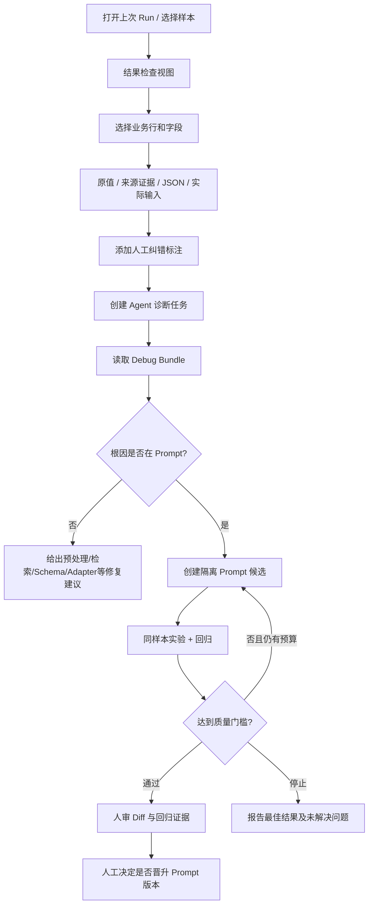
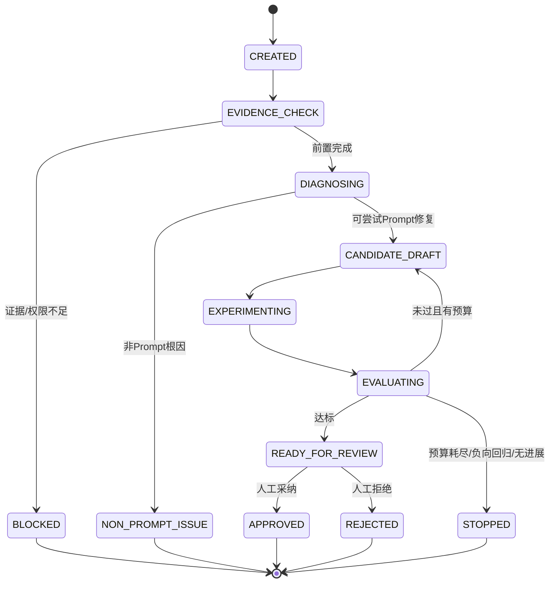
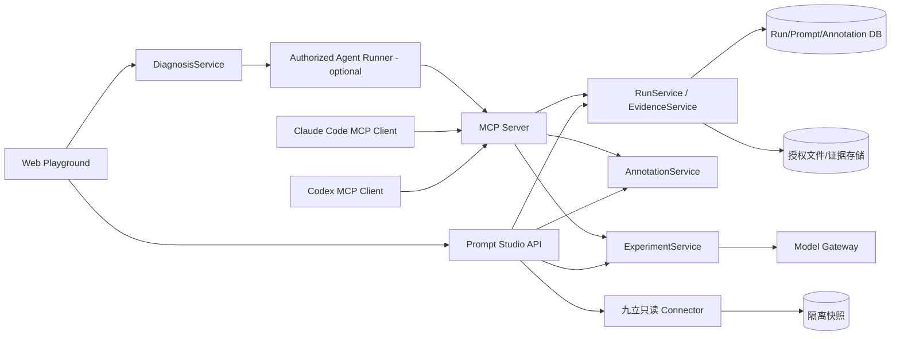

# Prompt Studio v1.3｜交互重构、Agent 诊断与自动优化 Loop 完整需求文档

> **文档性质**：现有项目增量 PRD + 技术契约 + Claude Code/Codex 开发执行规范  
> **版本**：v1.3 / 2026-10-12  
> **适用项目**：九立 AI 核对项目，未来可扩展到通用提示词工程及 FDE 工作台  
> **决策状态**：本文件为待仓库审计后执行的产品目标基线。UI 现状基于用户提供截图；未直接审计本机仓库。技术路径、接口名和表结构是实现建议，最终以仓库事实及兼容性评估为准。  
> **前置文件**：`Prompt Studio 首版 v1.0 PRD`、`Prompt Studio 功能审计与优化需求 v1.1`、当前仓库中正在使用的九立 P1～P4 Prompt/Schema/Fixtures。  
> **目标执行方**：Claude Code、Codex。不要把本文中的产品要求视为已经实现的功能。

---

## 0. 先读这里：目标、优先级、不可破坏的边界

### 0.1 产品结论

把现有 Prompt Studio 从“可以运行模型并展示 JSON 的 Playground”，升级为一套以 **Run（一次可复现的测试运行）** 为中心的工程工作台：

1. **结果优先**：用户选中样本后，默认看到商品结果、问题和下一步动作，技术数据按需展开。
2. **字段级检查**：点击业务字段即可联动模型原始 JSON、原始文件、定位依据、人工纠错标注。
3. **完整可复现**：每个 Run 保存实际发送的 Prompt、请求、文件预处理覆盖范围、模型响应、解析与适配结果、评测版本。
4. **Agent 可诊断**：Codex / Claude Code 可通过统一 MCP 服务按 Run / 字段读取授权证据，形成有依据的根因报告。
5. **Agent 可实验**：在隔离空间生成 Prompt 候选、测试、对比、回归，正式版本只能经人工审批提升。
6. **有限自动循环**：具备轮次、预算、负向回归、停止条件，允许“Prompt 不应修改”的诊断结论。

### 0.2 不变的冻结决策

| 编号 | 决策 | 约束 |
|---|---|---|
| F-01 | 方案 C：独立 Web 应用 + 九立只读连接 + 隔离测试空间 | 禁止从 Playground / Agent 写回正式客户池、委托任务、商品关系、人工确认与核销 |
| F-02 | 模型原始响应不可变 | 人工标注、JSON 修复预览、解析结果及 ViewModel 分层存储 |
| F-03 | 渲染链路：原始输出 → 解析 → Schema → Adapter → ViewModel → Renderer | 不让 LLM 按页面需求输出 HTML 或虚构关系 |
| F-04 | P1/P2/P3/P4 各有专用业务模板 | 优先复用已有组件、Schema 映射与配置 |
| F-05 | Prompt ≠ Schema ≠ Adapter ≠ 规则集 ≠ 输入快照 ≠ 模型 | 版本与哈希分别留痕 |
| F-06 | 业务事实与人工标注分离 | 不得把“模型自报 0 问题”当作准确率 100% |
| F-07 | 先查仓库、再修改 | 已有且验收通过的不重做，不因截图不可见就宣称未实现 |
| F-08 | 九立客户级隔离是硬边界 | 用户和 Agent 只能访问显式授权客户/项目/Run |

**业务核心**：P1 看委托事实，P2 看查货事实，P3 从委托商品出发选择查货候选并建立关系，P4 只对已确定关系做字段核验与 Patch。P3 不改字段；P4 不重做匹配或核销；25 个业务字段保留当前 Schema 的定义。上述职责参照原提示词方案，但**仓库现行 `jiuli-ai-v3`、v2.1 或其他版本的实际字段结构必须先扫描确定**，不得把本文件示例的路径视为现行数据事实。

### 0.3 本轮范围与出货顺序

- **P0-A（先做）**：代码与真实运行审计、UI 结果优先、字段详情、纠错标注、运行输入真实性、Run 完整证据的缺口补齐。
- **P0-B（第二步）**：Run Debug Bundle + 只读 MCP + Codex/Claude Code 分别完成一次端到端字段错误诊断。
- **P1-A（第三步）**：隔离 Prompt 候选、实验工具、版本 Diff、固定样本回归和基于证据的诊断报告。
- **P1-B（第四步）**：有预算/停止条件的 Optimization Session，多轮实验与待审批候选版本。
- **P2（明确暂缓）**：Agent 任意执行 shell、无人值守代码自动合并、生产发布自动化、多 Agent 自发协作、模板市场、组织级计费及复杂 RBAC。

**实施闸门**：前一阶段未满足验收，不得仅为了演示“AI 自动优化”而跳到后一阶段。最小首验以**一个九立字段错误 → Codex/Claude Code 读取完整证据 → 有来源的根因报告**为准。

---

## 1. 用户画像与真实使用旅程

### 1.1 核心用户

- Prompt 工程师：维护长规则型提示词，需验证是否改对、是否退化。
- FDE：同时检查材料处理、模型、上下文构建、Schema、候选检索、业务规则及 UI 适配。
- 项目 Owner/产品经理：用可读的业务视图、对比及诊断报告确认质量，不应先阅读上千行 JSON。

### 1.2 九立五种典型任务

| 场景 | 起点 | 关键动作 | 正确结束条件 |
|---|---|---|---|
| S-01 单字段识别错误 | P2 查货行“产地”模型值与原件不符 | 选字段 → 原文 → 纠错标注 → Agent 诊断 | 知道哪一层错、具体证据与下一步动作 |
| S-02 提示词修复验证 | P1 某发票单价冲突未报告 | 创建候选版本 → 同样本 A/B → 回归 | 指定错误修复、未出现超过阈值退化 |
| S-03 匹配错误 | P3 没有召回或错误选择查货行 | 查看候选集合/过滤原因/模型选择 | 区分“召回漏了”与“模型裁决错误” |
| S-04 字段规则错误 | P4 产地 UPDATE 规则不正确 | 查看字段旧值/候选值/作用范围/规则 ID | 找到规则或证据范围问题，Patch 不写正式业务 |
| S-05 批量回归 | P1/P2/P3/P4 版本升级 | 固定数据集 + 标准答案 + 成本预算 | 生成字段/关系/风险准确性、修复及退化报告 |

### 1.3 必须打通的核心操作流



---

## 2. 现状审计要求（开发前必须完成）

### 2.1 预检操作

1. 读取当前仓库目录、README、配置、启动脚本、依赖、环境变量名称（不显示凭据值）、DB schema、迁移文件、已有测试。
2. 查找当前 P1～P4 Prompt、PromptVersion、Run、Sample/Fixture、Renderer、Adapter、Schema、EvidenceViewer、Annotation、Compare、Connector 的实现。
3. 用已存在的方式启动开发环境并执行现有测试，记录基线；不得为绕过失败而删除测试。
4. 检查最新 Run 的真实输入/输出及截图可见的 `jiuli-ai-v3`、`v3.0-fix1` 与原先 v2.x 契约差异，记录版本兼容表。
5. 逐项核对 v1.0/v1.1 和本文件需求，标记：`PASS / IMPLEMENTED_UNVERIFIED / PARTIAL / MISSING / BLOCKED / N_A`。
6. 为每项提供**具体文件路径、函数/组件、运行/测试证据**，并写入 `docs/audit/v1.3-gap-matrix.md`。

**禁止行为**：不能只凭截图认定代码不存在；不能因为某个 React 组件文件存在就标记 PASS；不能删除或替换已经验收通过的核心架构。

### 2.2 代码审计输出样式

| ID | 能力 | 状态 | 当前代码位置 | 证据 | 缺口 | 方案 | 对现有功能的影响 |
|---|---|---|---|---|---|---|---|
| AUDIT-EXAMPLE | 结果优先默认布局 | PARTIAL（示例） | 待扫描 | 截图/交互测试 | Prompt 占主区 | 默认折叠编辑器 | 不改 Prompt 逻辑 |

若无现成只读接口、模型凭据或原材料，明确写为 BLOCKED，提供 Fixture fallback；不得声称“测试通过”或临时构造看似真实的结果。

---

## 3. 信息架构与页面重构（P0-A）

### 3.1 一级导航

保持左侧项目和 P1～P4 导航，但主操作区采用三种**工作模式**，而非重复叠加多层 Tab：

1. **结果检查**（默认）：业务结果占据全部主区域；样本/Prompt 作为折叠上下文条。
2. **提示词调试**：左侧 Prompt 与输入，右侧当前结果；可拖动分隔线。
3. **版本对比**：相同样本 Run A/B 并排展示，支持字段差异与结果同步滚动。

侧栏保留“项目、四个 Prompt、最近 Run、测试样本、优化会话”入口；无关技术详情不应永久显示。

### 3.2 结果检查默认布局

```text
┌ 项目 / P 阶段 / 当前样本 / Prompt 版本 / 模型 ────── [编辑Prompt] [运行] [Agent诊断] ┐
│ 运行成功 · 识别2行 · 0条已报告问题 · 准确性未评测 · 输入覆盖 1/1 │
├───────────────────────────────────────────────────┤
│ 商品结果（核心字段｜全字段｜仅异常｜搜索）                         │
│ 行01：型号/品牌/产地/数量...    [检查] [标注]                     │
│ 行02：型号/品牌/产地/数量...    [检查] [标注]                     │
├───────────────────────────────────────────────────┤
│ 待处理问题（无则紧凑一行，不占大卡片）                          │
│ 合计与范围 / 原始行 / 读取状态 → 默认折叠                        │
└───────────────────────────────────────────────────┘
                        选择字段后打开右侧详情抽屉
                        [原值·来源·JSON·人工标注·Agent分析]
```

- 顶部摘要优先显示**当前样本 + 结果状态**，不重复展示长版本标签和原始编码。
- `SUCCESS` 文案只能是“模型运行成功”，不可写“核对正确”。`issues=0` 显示“0 条模型报告问题”，不可写“无错误”。
- 未有 Gold 标注时显示“未评测”，不能计算正确率；读到的行数不等于原文事实行数。
- 表格默认“核心字段”，型号/序号可固定，长文本悬浮展示；全字段视图应自适应滚动。避免密集绿色小圆点；仅真正异常、差异、人工修改需要显著标记。
- `scope_records`、`unlinked_records`、`read_status` 翻译为“合计与覆盖范围 / 未关联记录 / 材料读取情况”，默认折叠，技术 key 在开发者详情显示。
- 零行/无异常/错误时呈现紧凑、可理解的空状态，不铺一整块“没有数据”。

### 3.3 样本选择

- 样本入口从常驻长列表改为搜索抽屉或弹层；选中后自动收起。
- 支持名称、P 阶段、场景标签、真实录制/人工构造/Gold/仅渲染、最近运行时间筛选。
- 每个样本摘要：样本 ID、类型、文件数、输入完整性、Gold 状态、关联 Run 与已知错误数。
- 选择样本后保留 Prompt 版本和模型配置，除非输入类型与该阶段冲突；冲突给具体提示和修复动作。
- 样本内容和人工正确值不得默认为模型系统提示词的一部分。

### 3.4 字段检查抽屉（关键交互）

选中单元格后抽屉展示：

1. **识别结果**：字段名称、当前值、位置（商品行 ID、`json_pointer`）、字段状态。
2. **来源证据**：`source_ref`、原文件/页/Sheet/单元格/原文，必要时展示完整图像区域；来源缺失则明确标注“不可追溯”。
3. **实际输入**：该部分内容是否进入模型、文本还是图像、预处理状态与截断情况。
4. **原始输出**：原始响应中对应节点，含解析和适配前后差异。
5. **人工标注**：正确/错误/无法判断、正确值、错误分类、备注、证据，保留标注历史。
6. **AI 分析问题**：创建 `diagnosis_session` 并自动绑定 Run ID、字段、标注及所选证据（**不自动全量泄露文件**）。

点击“问题卡”应定位对应商品与字段；点击 JSON 路径应反向高亮业务表；点击来源应定位源文件。切换表格/JSON/原文不丢当前选中对象。无对应定位时显示明确原因。

### 3.5 Prompt 编辑与 A/B 比较

- 保留章节导航、搜索、Prompt 版本选择、User 模板、保存新版本，避免重做。
- 主编辑区须区分**未保存编辑、当前保存版本、本次 Run 实际使用快照**。
- 保存新版本包含版本名与变更说明；提供统一 Diff，不得直接覆盖已冻结的稳定版本。
- A/B 同样本可比较字段值、来源、问题、关系、Patch、Schema 诊断、耗时、Token、成本。
- 不同样本、不同预处理版本或不同候选集合的 Run 允许技术 Diff，但必须显示“输入不可直接比较”的提示；不能算 Prompt 改进分数。

### 3.6 三种模式的默认规则与验收

| 模式 | 左主区 | 右主区 | 验收 |
|---|---|---|---|
| 结果检查 | 主区全宽业务结果 | 字段/Agent 按需抽屉 | 选中 Run 无需先编辑 Prompt 就能检查行与证据 |
| 提示词调试 | Prompt/输入/参数 | 业务结果 | 分隔线可调、Prompt 内容可搜、运行结果不丢 |
| 版本对比 | Run A | Run B + 差异摘要 | 字段同步定位，展示“修复/新增退化/未判定” |

建议记录用户最近工作模式及分栏大小；小屏可切换单栏而非强制超宽布局。可读字号不宜为塞入25列而无限缩小。

---

## 4. P1～P4 结果视图增量要求（P0-A）

### 4.1 通用适配约束

- 继续使用现有 Schema → Adapter → ViewModel → Renderer；新增数据不得靠前端读自然语言臆测。
- 按 `schema_version` 选择解析器/适配器。旧 v2.x `field_conflicts` 与新 v3 `issues`/`conflicts` 的兼容映射应根据**当前仓库事实**配置，不直接写死假定路径。
- 所有业务单元格保留原始 `json_pointer`、`source_refs`、业务对象 ID、Schema 版本；模型输出的临时 ID 不当作跨 Run 永久 ID。
- 渲染层不能自动补模型漏识别的商品行、来源或虚假关系；无法映射则提示诊断，保留原始 JSON。

### 4.2 P1：委托识别

默认商品 25 字段、来源与内部问题；人工关注“漏行、委托包内冲突、字段缺失、无牌和空值区别”。需要展示模型报告问题、客观规则发现问题、人工标注的三种来源，而不是混成“问题数”。原始行数未知时显示未知；有独立参照才可评估漏行。

### 4.3 P2：查货识别

入仓号 → 逻辑查货单 → 合并商品 → 原始查货行；支持反向展开、手写/印刷 COD/COA、`scope_uncertain`、权重范围与合并错误标注。原始行不因合并而丢失；查看完整 PDF 页及原件内容。

### 4.4 P3：商品关联

默认“委托行 / 全部候选 / 模型选择 / 对应证据”的候选表；关系图仅为可切换辅助模式。**必须区分正确候选没有进入 P3 输入（候选召回错误）和正确候选已在输入中但模型未选中（裁决错误）**。关联溯源到真实原始查货行；覆盖范围 `PARTIAL` 不展示为完整。

### 4.5 P4：字段核验与 Patch

显示“当前值 / AI 候选 / 决策 KEEP·FILL·UPDATE·CONFLICT·MISSING·NO_ACTION / 依据 / 风险 / Patch 模拟”。必须区分 `KEEP + VERIFIED_CONSISTENT` 与 `KEEP + NO_EVIDENCE`；Patch 预览只在独立草稿副本应用，不写回九立正式状态；人工锁不得被模拟实验静默覆盖。

---

## 5. 完整 Run 证据协议（P0-A，MCP 的前置依赖）

### 5.1 定义与不可变性

每次模型调用创建唯一 `run_id`；保存一份不可变的执行快照。以下内容属于事实层，更新只可新建派生记录或新 Run，不能重写历史：

- 实际执行的 System/User Prompt 文本、变量渲染结果、模板版本和哈希；
- 实际发送的消息结构（包括附件引用/图片部件描述），不包括机密 API Key；
- 原始材料文件哈希、来源引用、导入授权快照 ID；
- 预处理清单：每文件总页数/Sheet、成功抽取文本、转换图片、发送页码、未发送页码、截断、转换失败；
- Model/Provider、请求参数（包括思考模式是否真实被支持及启用）、响应格式；
- 原始响应、响应状态、token/耗时/成本可得值、错误与重试详情；
- Schema 解析、Adapter 诊断、Renderer 版本；
- P3/P4 上游 Run ID、候选集合和构建逻辑版本；
- 当时选用的 `prompt_version / schema_version / adapter_version / ruleset_version / preprocess_version / model_id`。

没有真实保存的字段以 `not_captured` 标记，**不得在回放时重新生成并声称是当时实际请求**。早期旧 Run 应标记采集不完整，并给出诊断能力限制。

### 5.2 Debug Bundle 文件逻辑清单

```text
RunDebugBundle/
  run-manifest.json          # 运行标识、版本、采集完整度、授权范围
  prompt-snapshot.json       # 当次真实执行的 Prompt、变量摘要和哈希
  request-actual.json        # 真实请求的脱敏结构，不含密钥
  input-manifest.json        # 文件、快照、引用与发送部件
  preprocessing-trace.json   # 页面/Sheet/图片/文本覆盖范围
  response-raw.json          # 原始响应或原始文本引用
  schema-diagnostics.json    # JSON/Schema 解析诊断
  adapter-diagnostics.json   # 业务 ViewModel 映射诊断
  provenance-index.json      # 字段 → source_refs → 文件定位
  annotations.json          # 读取时独立关联的人工标注
  evaluations.json          # 读取时独立关联的评测记录
  upstream-links.json       # P1/P2/P3 上下游依赖快照
  evidence/                 # 按权限/按需读取，不默认全量导出
```

Bundle 是逻辑结构，可以用 API 动态组装而非真复制一份目录。**核心字段必须能通过结构化接口读取、被独立测试；导出 ZIP 为可选扩展。**

### 5.3 数据模型样例（建议，不假装已有）

```json
{
  "bundle_version": "1.0",
  "run_id": "RUN_DEMO_1024",
  "project_id": "jiuli-demo",
  "prompt_stage": "P2",
  "customer_scope": "CUSTOMER_ID_A",
  "capture_quality": "COMPLETE",
  "prompt_snapshot": {"id": "PV_31", "sha256": "<real-sha256>"},
  "schema_version": "jiuli-ai-v3",
  "adapter_version": "adapter-v3",
  "preprocessor_version": "preprocessor-v1",
  "input_snapshot_id": "SNAP_1024",
  "actual_request_ref": "REQDATA_1024",
  "raw_response_ref": "RAW_1024",
  "preprocessing": {
    "files": [{
      "file_id": "F101",
      "type": "PDF",
      "page_count": 3,
      "sent_pages": [1, 2, 3],
      "omitted_pages": [],
      "image_pages": [1, 2, 3],
      "text_pages": [1, 2, 3],
      "truncated": false
    }]
  },
  "upstream_run_ids": [],
  "annotation_version": 4,
  "capabilities": {"raw_request_captured": true, "source_image_available": true}
}
```

`<real-sha256>` 为文档占位，不得写入正式业务。PII/敏感文件 ID 可以对外脱敏，但内部必须保证引用可追溯。

### 5.4 数据与诊断状态区分

| 状态 | 含义 | 行为 |
|---|---|---|
| `MODEL_RUN_SUCCESS` | 模型响应成功 | 仍需 Schema / 业务评测 |
| `PARSE_FAILED` | 非法 JSON 或无法解析 | 保存原始响应和错误偏移 |
| `SCHEMA_INVALID` | JSON 可解析但契约错误 | 报字段路径、类型、期望值 |
| `INPUT_INCOMPLETE` | 原件未完全进入模型 | 禁止声称“完整识别准确率” |
| `ADAPTER_ERROR` | 结构到视图映射失败 | 不能指责模型输出错 |
| `EVAL_NOT_AVAILABLE` | 缺 Gold | 只展示结果差异，不算准确率 |
| `EVAL_FAILED` | 有可靠答案且检查未通过 | 生成字段级错误项 |

### 5.5 输入真实性检查器

展示 PDF/Excel 原始页/Sheet、发送范围、图片发送情况、预处理转换失败、截断标记、实际请求中的附件列表。Provider 不能接受原 PDF 时应显式记录采用“文本 / 页面图像 / 混合”哪种方式，且禁止默认只发前 N 页却不提示。

---

---

## 6. 人工标注、Gold 和错误归因（P0-A）

### 6.1 Annotation 不允许覆盖原始响应

标注分三种：

- **字段标注**：正确 / 错误 / 无法判断，提供期待值和证据。
- **问题标注**：风险实际存在、误报、漏报；漏报需要明确正确风险类型及来源。
- **关系标注**：正确原始查货行集合、错误关联或候选缺失；关联需存依据。

要保存 `annotation_id`、`run_id`、`object_ref`、`json_pointer`、`source_refs`、`expected_value`、`actual_value_snapshot`、`annotator_id`、`created_at`、`revision`、`status`。不得将空值、数值零、“无牌”、无法辨认混成一种类别。人工修改一次产生新版本，并留下修改痕迹。

### 6.2 标注错误类型（建议枚举）

`INPUT_MISSING_PAGE / PREPROCESSING_ERROR / OCR_VISION_ERROR / PROMPT_RULE_ERROR / MODEL_REASONING_ERROR / CANDIDATE_RECALL_ERROR / RELATION_SELECTION_ERROR / SCHEMA_CONTRACT_ERROR / ADAPTER_MAPPING_ERROR / BUSINESS_RULE_ERROR / INCORRECT_GOLD / EVIDENCE_INSUFFICIENT / UNKNOWN`

允许先 `UNKNOWN`，Agent 读证据后提出根因；未验证的 Agent 猜测存为 `hypothesis`，**不能自动覆盖人工标签**。

### 6.3 Gold 的判定

- 真实录制模型结果 ≠ Gold；人工构造场景 ≠ 自动拥有真值。
- 只有明确经过授权人工检查、有来源依据与版本号的数据才可提升为 Gold。
- `gold_version` 必须固定，比较 Run 时明确使用哪一版 Gold。
- 没有 Gold 时允许检测 JSON/Schema/相同输入差异，不生成字段准确率。
- 使用数据集分层：`dev`（可供 Agent 迭代）、`regression`（受控回归）、`holdout`（保留评估集）。Agent 不得反复读取 holdout 标准答案并据此定向修 Prompt。

---

## 7. Agent 集成总体方案（P0-B）

### 7.1 两种独立链路——不能混淆

**链路 A：Agent 主动读取，先做。**

```text
用户在 Codex / Claude Code 打开已有项目
  → Agent 连接 Prompt Studio MCP Server
  → list/get Run、Prompt、证据、标注、评测
  → Agent 输出根因报告
```

**链路 B：Web 一键启动 Agent，后做。**

```text
用户在 Playground 点击“AI 分析问题”
  → 后端创建 Diagnosis Session
  → 本地 Agent Runner 或经过授权的受托执行器启动 Codex / Claude Code
  → 通过相同受控 API/MCP 读取 Run
  → 事件流写回 Prompt Studio 诊断面板
```

MCP Server **只提供可发现的受控数据与操作工具**，不能保证任意 Web 服务自动启动用户电脑本地的 Claude Code 或 Codex。网页一键运行必须明确部署运行器、授权方式、工作目录、隔离策略、断线/重试与执行日志。没有 Runner 时保留“复制 Agent 任务指令 / 在外部工具打开”的降级入口，不能伪装一键已成功。

官方实现参考：

- OpenAI MCP 构建说明：<https://developers.openai.com/plugins/build/mcp-server>
- Codex 客户端连接 MCP：<https://developers.openai.com/learn/docs-mcp>
- Codex SDK / app-server 与编程式控制：<https://developers.openai.com/blog/codex-as-a-platform>
- Claude Code MCP：<https://code.claude.com/docs/en/mcp>
- Claude Code 非交互执行：<https://code.claude.com/docs/en/headless>

使用当前环境实际安装的版本及官方文档核验具体 CLI 标志，不从本文示例凭空推断用户拥有对应订阅或模型权限。

### 7.2 MCP Server 安全与部署

- 首版在项目服务端封装同一个领域服务层（RunService/EvidenceService/ExperimentService），Web API 与 MCP 共用授权/审计，不得另写绕过授权的数据读取逻辑。
- MCP 支持合适的本地 stdio 或 HTTP 传输；具体取决于现有部署架构与 Agent 客户端支持情况。远程 HTTP 应使用 HTTPS、用户级鉴权、最小 scope。
- 不要用一个固定管理员 Key 让所有 Agent 读取全部客户数据。
- 工具返回结构化 JSON，长输出分页/摘要，提供引用或 `cursor`；原始文件默认按需、按范围读取。
- MCP 工具输出和 Run 中的原文均为**不可信外部数据**；不能把材料中的指令当成 Agent 的开发指令。
- 服务端做 project/customer ACL、限流、调用审计、有效期 Token 与附件出站审批。

### 7.3 第一批 MCP 工具合同

| 工具名（建议） | 阶段 | 输入关键字段 | 输出关键字段 | 权限 |
|---|---|---|---|---|
| `list_runs` | P0-B | project_id, stage?, sample_id?, status?, cursor, limit | run 摘要 + next_cursor | `runs:read` |
| `get_run_manifest` | P0-B | run_id | manifest、采集完整度、版本 | `runs:read` |
| `get_run_trace` | P0-B | run_id, parts[], object_ref? | 实际请求/预处理/原始响应/Schema/Adapter 诊断的受控片段 | `runs:read` |
| `get_prompt_snapshot` | P0-B | run_id 或 prompt_version_id | 真实 Prompt、变量、哈希、章节信息 | `prompts:read` |
| `get_source_evidence` | P0-B | run_id, source_ref, view=snippet/page/region | 原文、页/Sheet、定位、受控图像引用 | `evidence:read` |
| `get_annotations` | P0-B | run_id, object_ref? | Gold/人工标注/版本 | `annotations:read` |
| `get_evaluation` | P0-B | run_id, eval_version? | 评测值、条件、未评测说明 | `eval:read` |
| `compare_runs` | P0-B | base_run_id, candidate_run_id | 业务 Diff、输入可比较性、成本差异 | `runs:read` |
| `create_prompt_candidate` | P1-A | base_prompt_version, diff, reason, session_id | candidate_id、差异 | `experiments:write` |
| `run_experiment` | P1-A | candidate_id, dataset/snapshot, budget | experiment_run_id、任务状态 | `experiments:execute` |
| `evaluate_experiment` | P1-A | experiment_run_id, eval_policy_id | 指标、回归与闸门结果 | `eval:execute` |
| `get_optimization_session` | P1-B | session_id | 当前轮次、方案、预算、结论、事件 | `experiments:read` |

首版 MCP **不给**：写九立客户池、改变人工确认、核销、读取不相关客户、执行任意 Shell、无批准发布稳定 Prompt 等工具。

### 7.4 工具示例契约

请求（仅示意）：

```json
{
  "tool": "get_run_trace",
  "arguments": {
    "run_id": "RUN_DEMO_1024",
    "parts": ["actual_request", "preprocessing", "raw_response", "schema", "adapter"],
    "object_ref": {"row_id": "ROW_TMP_002", "field": "origin"}
  }
}
```

响应（仅示意）：

```json
{
  "run_id": "RUN_DEMO_1024",
  "capture_quality": "PARTIAL",
  "requested_scope": {"row_id": "ROW_TMP_002", "field": "origin"},
  "evidence_refs": ["EV_1024_03"],
  "diagnostics": [{"layer": "PREPROCESSOR", "code": "IMAGE_PAGE_NOT_CAPTURED", "message": "Page 2 image capture not recorded"}],
  "parts": {"actual_request": {"available": true}, "preprocessing": {"available": false}},
  "limitations": ["No full preprocessing trace was stored for this historical Run"]
}
```

要求：部分数据缺失就坦白返回，不用推断补齐。`object_ref` 必须匹配 Run 当时的 Schema/行 ID，找不到时返回明确 `NOT_FOUND` 或 `AMBIGUOUS_OBJECT_REF`。`source_ref` 必须校验属于该 Run 允许访问的证据范围，防止越权跨文件读取。

### 7.5 MCP 工具返回大小与上下文控制

- 每个工具结果有合理的字节限制，默认仅摘要；深度内容按需分段或资源引用下载。
- 运行原 PDF 页面图仅在 `evidence:read` 通过时访问，包含页码和文件哈希。
- 明确引用的文件哈希与版本；避免 URL 过期导致诊断无法复现。
- 图像、JSON、原始 Prompt 不必每轮全部重复传；Agent 先检索相关字段后深入。
- 出站传输必须受用户授权与日志记录；若选用外部模型供应商，先展示将被发送的数据类型及范围。

---

## 8. Agent 诊断（P0-B）

### 8.1 诊断会话与 UI

字段详情中点击「AI 分析问题」后：

1. 确认关联 Run、当前字段、人工标注、可访问证据及隐私设置。
2. 创建 `diagnosis_session`；若无人工标注也允许分析，但明确标注为“调查疑似问题”。
3. 优先运行证据完整性预检。如果没有实际请求/来源，报告缺失，不虚构根因。
4. 展示 Agent 读取的证据清单与引用、调查步骤状态、初步假设、反证及下一步方案。
5. 保留会话历史，可从 Run、商品行、Prompt 版本反向检索。
6. 如果 Agent 失败或取消，原 Run 与已存在的标注必须保留；可重新分析。

诊断面板建议 3 个页签：**诊断 / 修复候选 / 实验记录**。无实验时第三页提供“尚未开始”的真实状态，不渲染伪造实验结果。

### 8.2 结构化诊断报告（必须）

```json
{
  "diagnosis_id": "DIAG_1001",
  "run_id": "RUN_DEMO_1024",
  "target": {"stage": "P2", "row_id": "ROW_TMP_002", "field": "origin"},
  "status": "NEEDS_MORE_EVIDENCE",
  "observed_problem": "模型字段与人工标注不一致",
  "root_cause": {
    "category": "UNKNOWN",
    "summary": "原始页面是否进入模型请求尚未证实",
    "supporting_evidence_refs": ["EV_1024_03"],
    "counter_evidence_refs": [],
    "unverified_assumptions": ["图像可能未发送"]
  },
  "recommended_action": {
    "target_layer": "INPUT_PREPROCESSING",
    "action_type": "VERIFY_PIPELINE",
    "summary": "先核查实际发送页面与图片部件"
  },
  "can_start_prompt_experiment": false
}
```

字段最低要求：`target / observed_problem / verified_facts / root_cause_category / evidence_refs / limitations / proposed_change / impact_scope / verification_plan / result_status`。允许 `UNKNOWN` / `NEEDS_MORE_EVIDENCE`，不能强制 Agent 在证据不足时给确定错误归因。支持 `supporting`、`counter` 和“无法证明”的明确区分。

### 8.3 调查顺序（建议系统任务模板）

1. **确认定位**：Run、Stage、对象、字段、标注与期望值是否合法关联。
2. **核查输入**：是否真正发送该原件区域、是否裁剪/截断、预处理是否丢信息。
3. **核查原始输出**：模型原始响应是否就错误，还是 Schema/Adapter/Renderer 使其显示错误。
4. **核查业务规则**：读取实际运行 Prompt 的相关章节、当时 Schema、规则 ID 和候选上下文。
5. **核查反事实**：该错误是否可由 Prompt 修改，或需要文件处理/代码/召回/Gold 修正。
6. **给出可执行结论**：根因类别、被证实事实、缺失证据、最小修复方式、应回归的样本。

**判定约束**：正确查货候选未进入 P3 输入→优先 `CANDIDATE_RECALL_ERROR`；正确候选已在输入且模型误判→ `RELATION_SELECTION_ERROR`；模型原始 JSON 对而 UI 值错→优先 `ADAPTER_MAPPING_ERROR`。避免把所有问题都建议“再写长一点 Prompt”。

### 8.4 Agent 独立诊断任务模板

```text
你是 Prompt Studio 的独立问题诊断 Agent。目标 Run：{run_id}，对象：{object_ref}。
先通过已授权的 Prompt Studio MCP 工具读取 run manifest、真实请求、预处理、原始响应、Schema/Adapter、关联人工标注和来源证据。
按输入/预处理、Prompt规则、模型判断、候选召回、Schema/Adapter、Gold六个方向排查。
每一条根因结论引用 evidence_ref；证据不足必须标明未确认，不能凭最后 JSON 臆测。
优先输出结构化诊断报告，说明最小修复对象、修改范围、验证测试。此次只读诊断，不修改稳定 Prompt、代码或九立业务数据。
```

---

## 9. Agent Runner 与网页内一键诊断（P1-A，可在只读 MCP 验证后做）

### 9.1 选型约束

- **外部 Agent 路径**：用户在本机已安装的 Codex/Claude Code 中配置 MCP，使用既有登录授权，无需平台托管调用。首版优先。
- **浏览器一键路径**：必须具备独立 Runner（本机守护进程、授权执行器或专用服务），不能让浏览器随意执行本地 CLI。
- Codex 可以按当前官方支持优先评估 SDK/app-server；Claude Code 可评估 Agent SDK/受控非交互 CLI。**先做能力探测，不假设平台可调用用户已有的会员订阅或任意本地凭据。**
- 每个 Runner 必须暴露统一 `AgentExecutionAdapter`：`start / events / cancel / status / result`，并有明确的 `provider`, `working_directory`, `allowed_tools`, `model`, `resource_policy`。
- 未安装或未授权时，提供“配置引导/复制任务指令”，而不是显示已连接成功。

### 9.2 事件流与取消

建议任务状态：`CREATED → EVIDENCE_CHECK → RUNNING → NEEDS_INPUT / SUCCEEDED / FAILED / CANCELED / TIMED_OUT`。事件包括阶段、tool 名称、耗时、引用与错误，**不显示 Agent 隐藏推理内容**；只展示可审计的工具调用摘要、读取证据、外部输出及诊断报告。

### 9.3 权限

- Agent 分级：`read_only` / `experiment` / `approval_required`。
- 提升到 `experiment` 需要用户明确授权当前会话及数据集，默认只能访问隔离实验存储。
- 代码/配置文件修改必须在已确认的工作目录与 Sandbox 内进行；Git diff 提交用户审批，不能自动合并。
- 对外部模型传送原始材料前，需要按用户授权策略提示数据出站范围。

---

## 10. Prompt 候选实验与回归评测（P1-A）

### 10.1 实验对象

`Experiment = baseline_prompt_version + candidate_prompt_version + fixed_input_snapshot + provider_config + evaluation_policy + test_set_version + budget`。

每次实验必须生成新 Run，不复写历史响应。候选 Prompt 是原版的 fork，记录 Diff、变更原因、关联 diagnosis_id。任何自动实验都只针对测试数据，不应用业务核销/客户状态。

### 10.2 实验步骤

1. 用户或 Agent 从诊断报告创建**最小范围 Prompt Diff**。
2. 系统验证候选文本不为空、不破坏必须的 Schema/业务硬约束，保存新 Candidate，禁止覆盖稳定版。
3. 在目标失败样本上执行，记录模型与输入配置。
4. 对同类型开发样本执行，再对独立回归集执行。
5. 显示字段/关系/风险评测结果、Token/耗时/费用、结构错误、修复样本与新增退化。
6. 基于业务闸门决定“可供人审 / 失败 / 证据不足”；不自动把成功模型响应判为质量提升。

### 10.3 最小比较维度

| Prompt | 核心评价指标 | 硬性回归检查 |
|---|---|---|
| P1 | 商品行召回、25字段正确、委托包冲突发现、来源定位 | 漏行、虚构交易数值、客户错误 |
| P2 | 原始行召回、入仓号边界、合并关系、COD/COA/Origin、重量范围 | 假入仓号、错合并、丢原始行、手写误读 |
| P3 | 正确关系数、误匹配、漏匹配、多候选风险、原始行覆盖 | 跨客户、候选凭数量凑配、已核销行错误复用 |
| P4 | KEEP/FILL/UPDATE等动作正确、来源/规则正确、风险提示、Patch可用性 | 交易字段错误覆盖、范围不完整却更新、人工锁被覆写 |

评估需明确样本基数与适用字段；不能把“0条模型报告问题”当作 0 个真实错误。

### 10.4 实验可比性

严格比对材料哈希、输入快照、文件预处理版本、模型 ID 与参数、候选集合、Schema、Gold 版本。如果不同，显示相应警告；允许进行探索性对比，但不作为证明 Prompt 单独带来提升的依据。非确定性模型可对关键样本重复运行并保存每次结果，避免仅靠单次波动宣称获益。

### 10.5 结果报告

- 目标错误是否修复、证据定位；
- 原先正确变错误的样本和字段（新增退化）；
- 模型输出格式与来源引用是否仍完整；
- 对关键高风险错误的硬门槛校验；
- 耗时、Token、成本变化及可比性说明；
- Prompt Diff、已用实验预算、仍未解决的错误；
- “建议合并 / 不建议 / 无充分证据”的结论及人工审批入口。

---

## 11. Optimization Session：有限多轮自动优化（P1-B）

### 11.1 产品概念

用户选择目标错误或带标注的数据集，设置目标与约束，系统循环执行：**读取证据 → 根因假设 → 候选 Diff → 隔离运行 → 回归 → 对照 → 决定是否继续**。

“自动优化”不等于强制只改 Prompt；当 Agent 诊断属于 `INPUT_PREPROCESSING / CANDIDATE_RECALL / SCHEMA / ADAPTER / INCORRECT_GOLD` 时，本会话应转为技术修复建议或代码变更草案流程，不允许继续无限迭代提示词。

### 11.2 状态机



### 11.3 默认预算和停止条件（可调整，首版保守）

| 限制 | 建议默认 | 实施注意 |
|---|---|---|
| 最大迭代 | 3 轮 | 用户可减少/增加，服务端设硬上限 |
| 最大实验 Run | 每轮按数据集预估，超预算前停止 | 预览预计调用次数和成本 |
| 最大费用 | 用户显式配置；未配置则禁止自动连续调用 | 不得凭空估计实际已花费用 |
| 超时 | 单次与会话双重超时 | 任务可取消，未完成数据保留 |
| 回归闸门 | P1/P2 漏行、P3 跨客户、P4 错误覆盖等零容忍或明确阈值 | 真实阈值由当前项目策略与业务标注确定 |
| 无 Gold | 只允许结构测试和探索性差异 | 禁止宣称准确率提升 |
| 连续无改进 | 达到配置次数即停 | 不无限扩大 Prompt 文本 |
| 输入缺失/证据不足 | 中断并生成修复前置建议 | 不循环运行不完整数据 |

### 11.4 Prompt 候选与审批

- 每轮候选必须有 `candidate_id / parent_prompt_version / prompt_diff / diagnosis_id / test_runs / regression_report`。
- Agent 可自动创建隔离 Candidate，但不能改 `stable_prompt_version` 指针。
- 用户必须看到具体文本 Diff、适用范围、已经跑过的测试、风险和预估影响，然后**明确点击审批**才可晋升 Prompt 版本。
- 拒绝后保留实验历史；无通过候选时只报告最优已知候选，不应自动发布。
- 若涉及工程代码修复，生成单独补丁/PR 草案；不得混在“自动 Prompt 优化成功”里。

---

## 12. 技术架构与接口契约

### 12.1 推荐架构（允许根据现有代码复用）



系统接口以当前已有实现优先，不强制为了 REST 风格重构所有代码。

### 12.2 建议的领域实体

| 实体 | 最少字段 | 不变量 |
|---|---|---|
| `Run` | id, project, stage, input_snapshot, prompt_snapshot, model, status, timestamps | 一次实际调用只对应一份不可变输出 |
| `RunArtifact` | run_id, kind, hash, storage_ref, capture_status | 证据是否真实存在需可查 |
| `PromptVersion` | id, parent_id, stage, content_hash, content, author, status | stable 不能自动覆盖 |
| `SchemaVersion` | id, schema_hash, version | 同 Run 绑定精确版本 |
| `Annotation` | id, run_id, object_ref, value, evidence_refs, revision | 标注是独立层 |
| `Evaluation` | run_id, gold_version, policy, result, sample_counts | 无 Gold 不算准确率 |
| `DiagnosisSession` | id, run_id, target, agent, status, report, events | 诊断可复现，可列出引用 |
| `PromptCandidate` | id, baseline_version, diff, origin_session, content_hash | 在隔离命名空间 |
| `ExperimentRun` | id, candidate_id, snapshot_id, budget, status, output_run_id | 与正式 Run/业务存储隔离 |
| `OptimizationSession` | id, objective, dataset, budget, iterations, status, best_candidate | 有边界、有终止状态 |
| `AgentAccessGrant` | id, principal, scopes, project/customer, expires_at | 访问与撤销有据可查 |

### 12.3 API 建议（以仓库已有路径为准）

| HTTP（建议） | 作用 | 要求 |
|---|---|---|
| `GET /api/runs/:id/manifest` | Run 基本信息与版本 | ACL |
| `GET /api/runs/:id/trace?parts=...` | 按需获取运行证据 | 分页、脱敏、审计 |
| `GET /api/runs/:id/evidence/:ref` | 来源定位及授权读取 | 防止跨 Run 猜 ID |
| `POST /api/runs/:id/annotations` | 新增标注 | 不覆盖原始响应 |
| `GET /api/runs/compare?base=&target=` | A/B 差异 | 可比性提示 |
| `POST /api/diagnoses` | 创建字段诊断任务 | 绑定 run+target+授权 |
| `GET /api/diagnoses/:id` | 诊断状态与报告 | 用户范围隔离 |
| `GET /api/diagnoses/:id/events` | SSE/轮询事件 | 断线续读 |
| `POST /api/experiments` | 创建隔离候选实验 | 权限、预算、幂等键 |
| `POST /api/experiments/:id/run` | 执行实验 | 仅测试快照 |
| `POST /api/experiments/:id/evaluate` | 评测与回归 | 策略/GOLD版本锁定 |
| `POST /api/optimizations` | 启动有限自动循环 | 显式预算/停止条件 |
| `POST /api/optimizations/:id/cancel` | 取消 | 安全终止、防重复计费 |
| `POST /api/candidates/:id/promote` | 晋升 Prompt | 人工审批、写审计日志 |

### 12.4 幂等、并发与失败

- 每次运行/实验带 `idempotency_key`，网络重试不得重复创建多次运行或重复扣预算。
- 异步任务可取消、可查询、保留失败原因和已完成的 Artifact；任务执行成功不等于评测成功。
- 同一 Optimization Session 的状态转移使用乐观锁/事务控制，避免并发 Agent 同时覆盖最佳候选。
- 长任务事件有序且可断线恢复；证据被删除/权限失效时诊断应终止并明确错误。
- 外部工具抛出错误或超时，UI 显示完整错误分类，不虚构成功状态。

### 12.5 建议的代码模块（非强制路径）

```text
src/
  domain/run/
  domain/prompt/
  domain/annotation/
  domain/evaluation/
  domain/diagnosis/
  domain/experiment/
  integrations/jiuli-readonly/
  integrations/mcp/
  integrations/agents/codex/
  integrations/agents/claude-code/
  components/playground/
  components/renderers/
  components/evidence/
  components/agent-diagnostics/
  tests/fixtures/
  tests/integration/
```

先复用已有功能，不要仅为了符合目录示例而迁移整个工程。

---

## 13. 安全、隐私与风险边界

### 13.1 核心安全控制

1. **只读生产 Connector**：只允许读取已授权数据及创建本系统本地副本；写入测试快照须落 Prompt Studio 专用数据库，而非九立正式库。
2. **最小权限**：不同用户/Agent 的项目、客户、字段与文件权限独立验证；服务端校验，不由前端控制。
3. **外发确认**：公司文件、报关金额、客户身份等材料发给外部模型供应商前按授权策略处理；明示图片/文本/原文件的范围。
4. **机密管理**：任何日志/Debug Bundle/MCP 返回不得包含 API Key、访问 Token 或完整授权 Cookie；凭据存于机密服务/受控环境变量。
5. **不可信输入隔离**：Prompt、PDF 文字、模型输出、MCP 资源的自然语言均按数据而非系统指令处理，防止 prompt injection。
6. **证据资源保护**：防 ID 猜测、目录穿越、SSRF、任意路径读取、过期链接滥用；来源读取限制在已登记的 Artifact 清单中。
7. **Agent 工具白名单**：默认仅授权读工具。实验写权限只作用隔离命名空间，权限到期自动失效。
8. **审计**：记录谁读取了哪一份运行证据、启动了哪次实验、提升了哪个 Prompt 版本。
9. **数据保留**：支持按项目策略设置保留期限、删除/撤销授权及关联索引失效处理；不擅自删除正式业务记录。
10. **运行工作目录限制**：自动执行 Agent 不能把客户原文当命令执行；代码修复需在指定 sandbox/worktree、人工审核 diff。

### 13.2 三层权限

| 层级 | 允许能力 | 禁止能力 |
|---|---|---|
| `DIAGNOSE_READ` | 读取授权 Run 与证据、创建诊断报告 | 变更模型配置、Prompt Stable、业务数据 |
| `EXPERIMENT_ISOLATED` | 创建 Candidate、执行测试、保存回归 | 正式发布、业务核销、生产写回 |
| `PROMOTE_WITH_APPROVAL` | 用户批准后提升 Prompt Stable 指针 | 绕过审计/跨项目发布 |

### 13.3 Demo 阶段最低安全验收

即使采用单人本地部署，仍必须证明只读 Connector 无更新/删除权限；MCP 不提供任意文件路径 API；Agent 无法读取跨客户证据；实验不会更新正式库；外部发送授权被记录。

---

## 14. 开发里程碑与依赖关系

### M0｜审计现有代码、稳定运行基线（必须第一个交付）

**输入**：现有仓库、v1.0/v1.1 PRD、真实 v3 Schema/Fixture（如有）、最新页面。  
**完成物**：gap-matrix、运行方式、旧功能证据、Schema 兼容映射、风险列表。  
**验收**：能解释现在“提示词调试”和“结果检查”模式各自实际完成哪些流程，并展示至少 P1 的真实/Fixture Run。

### M1｜结果优先与字段检查（P0-A）

**范围**：模式布局、样本抽屉、字段抽屉、JSON/证据关联、人工标注、输入真实性、Prompt Run 快照缺口。  
**验收**：在 P1/P2/P3/P4 各选一个 Run，不离开当前业务结果页面即可定位来源、标注错误，并再次打开历史回放；不破坏现有 Renderer。

### M2｜Run Debug Bundle + MCP 只读（P0-B）

**范围**：manifest、真实请求及预处理链、来源读取、最小八个 MCP 只读工具、权限、审计、两类客户端配置说明。  
**验收**：在 Codex 和 Claude Code 里分别按 Run ID 读取相同对象，输出一份有 evidence_ref 的根因报告；缺证据场景明确返回未知。

### M3｜隔离候选与实验（P1-A）

**范围**：候选版本 fork/Diff、固定样本输入、多轮 Run 保存、版本差异与回归指标、预算/人工批准接口。  
**验收**：Agent 提出一次最小 Prompt Diff、执行至少目标样本 + 一组回归样本，报告修复/退化/未判定，正式稳定版本不变。

### M4｜Optimization Loop + 网页内 Agent Runner（P1-B）

**范围**：有限状态机、异常中止、预算、事件追踪、最优候选、审批、按需 Runner 连接。  
**验收**：用可控错误样本完成最多三轮的自动实验，并在达标/证据不足/预算耗尽/非 Prompt 根因四种条件下正确停止。

**阶段出货要求**：M0/M1/M2 应可独立验收和提交；不能把 M4 做成无实际证据支撑的按钮动画。

---

## 15. 验收测试（必须有自动测试或可重放手工证据）

所有测试须标记 `PASS / FAIL / BLOCKED / N_A`，包含样本来源、Run ID、截图/日志、测试代码位置及复现步骤。

### 15.1 UI / 交互（UX）

| ID | 验收用例 | 通过标准 |
|---|---|---|
| UX-01 | 选择样本并进入结果检查 | 样本列表自动收起、结果区域成为主视觉 |
| UX-02 | 切换提示词调试 | Prompt/结果分栏可调，返回结果检查不丢 Run |
| UX-03 | 切换版本对比 | A/B 同样本展示差异及输入可比性 |
| UX-04 | 查看 25 字段 | 核心字段与全字段，长型号不会无意义占多行 |
| UX-05 | 选择字段 | 自动打开字段详情，展示 JSON 路径及证据 |
| UX-06 | 点击问题 | 定位正确商品行、字段和来源 |
| UX-07 | 无问题返回 | 显示“模型未报告问题”，不冒充“结果正确” |
| UX-08 | scope/未关联/读取详情 | 默认折叠，展开可查看完整技术记录 |
| UX-09 | Prompt 改动未保存 | 显示编辑态，Run 绑定实际内容哈希 |
| UX-10 | 样本过滤 | 名称、阶段、类型、Gold 状态筛选有效 |
| UX-11 | 复查历史 Run | 不重新扣调用成本且渲染一致 |
| UX-12 | 空/失败/权限不足状态 | 明确错误与下一步，不出现虚假完整结果 |

### 15.2 数据真实性与证据（RUN）

| ID | 验收用例 | 通过标准 |
|---|---|---|
| RUN-01 | PDF 共 25 页但只发送 20 页 | 显示未发送 5 页，标记输入不完整 |
| RUN-02 | Excel 含 3 个 Sheet 仅解析 1 个 | 记录实际发送 Sheet，不能假装完整 |
| RUN-03 | Provider 不支持当前文件 | 拒绝或明确转换路线及覆盖范围 |
| RUN-04 | 模型返回合法 JSON 但违反 Schema | 显示契约错误路径，不报模型调用失败 |
| RUN-05 | 模型 JSON 正确但 Adapter 映射错误 | 能定位为 Adapter 层错误 |
| RUN-06 | 没有 Gold 的真实录制样本 | 不显示准确率数字 |
| RUN-07 | 人工改标注 | 原始模型响应保持哈希一致，标注修订留痕 |
| RUN-08 | Run 重放 | Prompt/模型/输入/处理器版本和哈希可查 |
| RUN-09 | 旧 Run 未记录实际请求 | `capture_quality=PARTIAL`，不伪造当时请求 |
| RUN-10 | 跨 Run `source_ref` | 服务端拒绝越权引用 |

### 15.3 P1～P4 专项（J）

| ID | 用例 | 通过标准 |
|---|---|---|
| J-01 | P1 委托与发票单价不同 | 同时查看各候选及来源，不静默覆盖 |
| J-02 | P1 有可能漏行 | 只有存在原文/Gold 依据时才给漏行判断 |
| J-03 | P2 同型号/品牌/产地合并 | 展开保留所有真实原始行 |
| J-04 | P2 COD 手写与印刷 Origin 不同 | 来源类别与原文定位正确显示 |
| J-05 | P3 正确候选不在输入 | 标记候选召回缺陷，而非强迫修改 Prompt |
| J-06 | P3 正确候选存在却选错 | 标记关系裁决缺陷并保留候选表 |
| J-07 | P3 只有部分数量覆盖 | 不显示完整覆盖 |
| J-08 | P4 KEEP 与无证据 | 区分 VERIFIED_CONSISTENT / NO_EVIDENCE |
| J-09 | P4 人工锁 + AI 更新 | 只读 Patch 模拟不能静默覆盖人工值 |
| J-10 | P1～P4 Schema 版本不同 | 分别选择正确适配器，不把 v2.x 强装 v3 |

### 15.4 MCP / Agent（AG）

| ID | 用例 | 通过标准 |
|---|---|---|
| AG-01 | Codex 通过 MCP 读取 Run | 获得同一完整 manifest、受控证据 |
| AG-02 | Claude Code 通过 MCP 读取同 Run | 与 AG-01 语义一致，未泄漏密钥 |
| AG-03 | Agent 读取字段相关证据 | 能追溯 Run/row/field/file/page |
| AG-04 | 运行只有最终 JSON、缺预处理日志 | Agent 只能输出“不确定/证据不足” |
| AG-05 | 输入缺页面且识别错误 | 诊断先指出预处理问题，不盲目改 Prompt |
| AG-06 | Schema 错误 | 诊断定位结构层和精确路径 |
| AG-07 | P3 候选遗漏 | 报告候选召回错误及输入集合证据 |
| AG-08 | 不同用户跨客户读证据 | 接口返回权限错误且记录审计 |
| AG-09 | 未授权工具尝试写生产 | 无可用入口、服务端拒绝并审计 |
| AG-10 | 材料内嵌恶意指令 | 仅当数据处理，不使 Agent 执行 |
| AG-11 | 中断 Agent 任务 | 可取消，状态真实，历史记录保留 |
| AG-12 | Agent 一键启动未配置 Runner | 显示明确配置缺失和外部工具降级方案 |

### 15.5 实验与 Loop（EXP）

| ID | 用例 | 通过标准 |
|---|---|---|
| EXP-01 | 创建 Prompt 候选 | 仅独立保存候选，stable 不变 |
| EXP-02 | 同样本版本比较 | 材料/模型/预处理/Gold 可比性可见 |
| EXP-03 | 回归含修复与退化 | 两类样本分别列出，不能只报净改善 |
| EXP-04 | 无 Gold | 不计算准确率，标注待评测 |
| EXP-05 | 三轮预算耗尽 | 自动停止，有最佳候选与费用报告 |
| EXP-06 | 触发关键规则硬回归 | 标记失败，禁止自动晋升 |
| EXP-07 | 非 Prompt 根因 | 停止 Prompt Loop，转修复建议 |
| EXP-08 | 用户人工审批通过 | 仅提升目标 Prompt 版本指针、留痕 |
| EXP-09 | 用户拒绝候选 | 稳定版本不变，实验历史保留 |
| EXP-10 | 重试相同幂等请求 | 不重复创建实验及花费 |

---

## 16. 开发质量与交付格式

### 16.1 交付证据

每阶段必须交付：

- 功能审计矩阵（当前实现、缺失项、风险与复用策略）。
- 代码 Diff 摘要（每个修改文件、目的、影响面），不输出大量无关重构。
- 数据库/Schema 迁移清单、兼容旧 Run 的处理方式。
- 运行环境、依赖配置、MCP Client 连接文档（不得提交真实 Key）。
- 自动测试执行结果、失败/阻塞原因、可重现的样本/Run ID。
- 至少 1 条**完整操作旅程**的截图或屏幕录制：字段错误 → 证据 → 标注 → MCP 诊断；M3 再增加候选与回归。
- 未实现项和下一步优先级；明确区分已运行实测与仅静态代码确认。

### 16.2 完成（Done）判定

不能用“页面有入口”“状态显示成功”“模型运行过一次”认定完成。只有真实输入、真实运行/Fixture 说明、错误定位、证据读取、权限、回放、对应验收用例均通过，才可标记 PASS。Agent 环节要求**诊断引用真实 evidence_ref**，不接受没有证据的泛泛总结。

---

## 17. 可直接交给 Claude Code / Codex 的执行指令

> 将本节与全文一起提供给编码 Agent。建议先要求它只完成 M0 审计并返回矩阵，审核后再启动 M1/M2，避免一口气改坏现有工作台。

```text
任务：在现有 Prompt Studio 仓库中增量实现《Prompt Studio v1.3｜交互重构、Agent 诊断与自动优化 Loop 完整需求文档》。

最高原则：先审计，复用已有能力，不推倒重建；先保障数据真实性与可复现，再开发 Agent；先 MCP 只读诊断，再隔离实验，最后有界 Loop。

启动前：
1) 扫描项目仓库、v1.0/v1.1 规格、现有 P1～P4 Prompt/Schema/Adapter/Renderer、Run/样本库/九立只读连接、模型配置、当前页面和已有测试。
2) 特别核对当前使用的 jiuli-ai-v3、v3.0-fix1 与历史 v2.x 的真实结构，不能猜测字段路径。
3) 生成 docs/audit/v1.3-gap-matrix.md；每条写 PASS/未验证/部分/缺失/阻塞、代码位置、测试证据、是否需要修改。
4) 不调用外部 API 作无必要探测；无权限或无凭据时以明确 Fixture 完成可运行验证，不请求我提供新 API Key，除非接入真实模型确属不可替代且当前环境未配置。

开发顺序：
M0 仓库级审计及测试基线；
M1 结果优先布局、业务字段证据抽屉、人工标注、Run 实际输入真实性与不可变快照；
M2 Debug Bundle 和最少八项只读 MCP 工具，分别在 Codex 与 Claude Code 完成真实字段级根因诊断；
M3 隔离 Prompt Candidate、实验、A/B、Gold/回归、预算与审批；
M4 多轮有限 Optimization Session 以及可授权的一键 Agent Runner。

严格边界：
- 九立 Connector 只读，不得从 Playground / Agent 更改真实客户池、委托任务、商品关系、确认、占用和核销；
- Prompt Studio 原始 Run 不可改写；标注、模拟 Patch、候选版本、评测独立存储；
- 不允许 Agent 为了通过测试修改 Gold、跳过失败用例、静默放宽 Schema 或伪造来源；
- 不得把所有错误都归因于 Prompt；必须区分输入/预处理/模型/候选召回/业务规则/Schema/Adapter/Gold；
- MCP 工具授权必须在服务端实现，禁止越权读取原材料/任意本地路径；
- 不得自动晋升稳定 Prompt，也不得无人审批提交生产代码。

每一阶段结束：
先启动应用和测试，回报可复现 URL/命令、具体变动、验收 ID 与结果、Run ID/截图、真实阻塞项；不要以“已开发完”四个字代替交付。若无法验证，应标注 IMPLEMENTED_UNVERIFIED，不能写 PASS。

现在先做 M0：审计、真实契约对齐、gap matrix 和最小交互/运行可复现报告。审计完成后再按本需求的依赖顺序实现后续阶段。
```

---

## 18. 仍需现场核实、不应由 Agent 自作主张的事项

1. **最新 P1～P4 Schema**：截图表明当前已出现 `jiuli-ai-v3` 与新版 Prompt，但具体输出字段需从仓库读取后冻结兼容关系。
2. **现有 Run 的证据完整度**：早期运行是否真的保存“当时实际请求”和预处理页级记录，需核查；缺失不能倒填伪历史。
3. **九立只读 Connector 的实现**：具体 API、数据库视图还是文件快照，须验证“真正只读”；没接口仍允许 Fixture 路线。
4. **真实图片输入**：当前模型网关是否支持图像部分、具体 PDF/Excel 转换策略、单次图片数量限制由实际能力决定。
5. **Agent 部署位置**：本机 CLI、用户侧服务或受托 Runner——决定网页一键启动的可行性与权限方式，不影响先做只读 MCP。
6. **业务质量闸门**：字段准确率、错配零容忍范围、预算上限、数据集划分和脱敏政策由实际业务 Owner 审批。

---

## 19. 最终产品验收场景（贯通演示）

**九立 P2 产地错误**：用户选中一份真实或注明构造的查货样本、执行模型、看到某商品产地值与人工答案不同；点击字段即看到原文件页/原文与实际发送的页图像、模型原始输出及 JSON 路径；标注错误；在 Codex/Claude Code 输入 Run ID 后，Agent 自动读取授权完整证据，先判断输入完整性，再定位是识别规则还是预处理导致的错误，输出带引用的报告。若属于 Prompt 问题，则创建隔离候选并在固定样本回归；报告修复与退化，用户人工选择是否提升新版本。

**只有这条链路真实通过，才能说 Prompt Studio 从可视化 Playground 变成了可追溯、可验证、可与编码 Agent 协作的 Prompt 工程工作台。**
